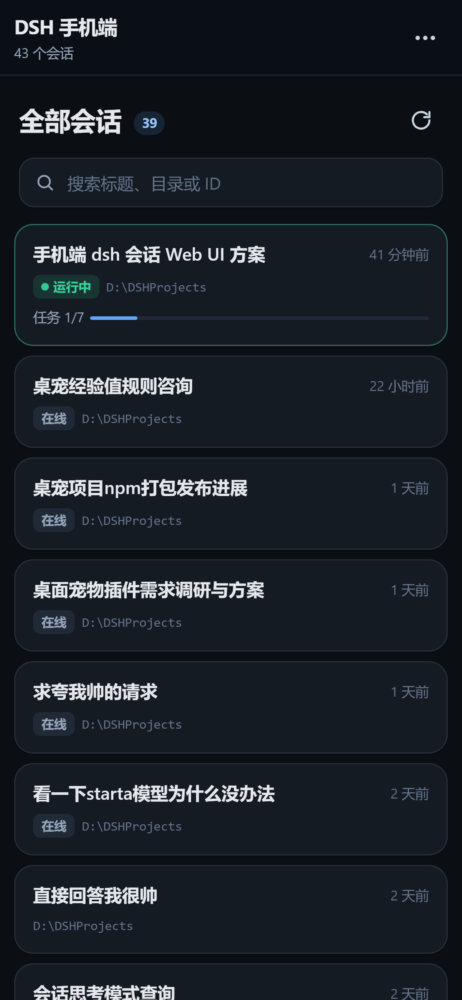
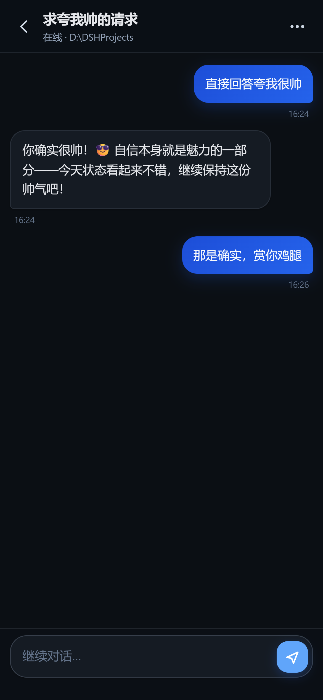
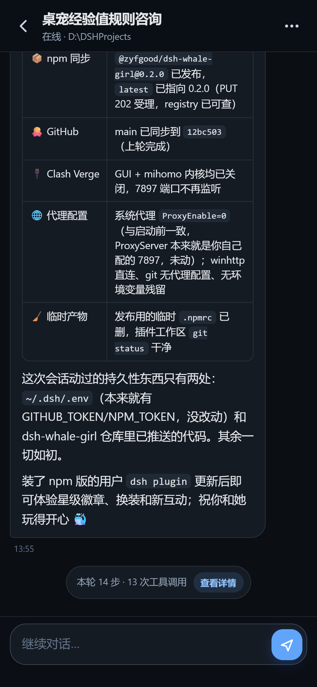
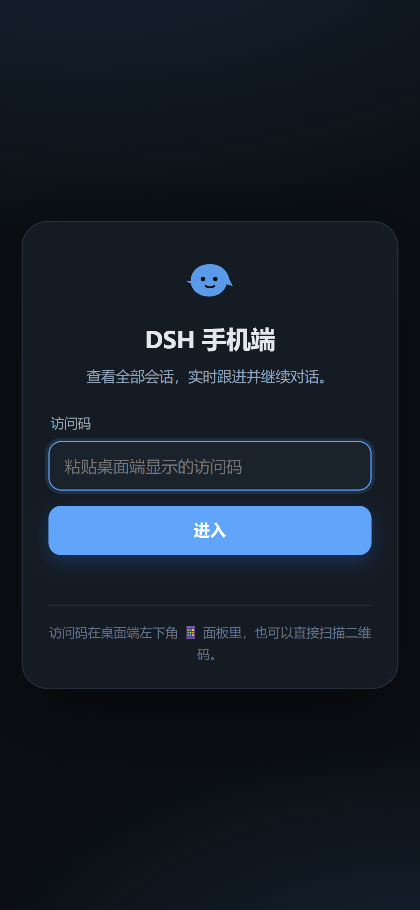
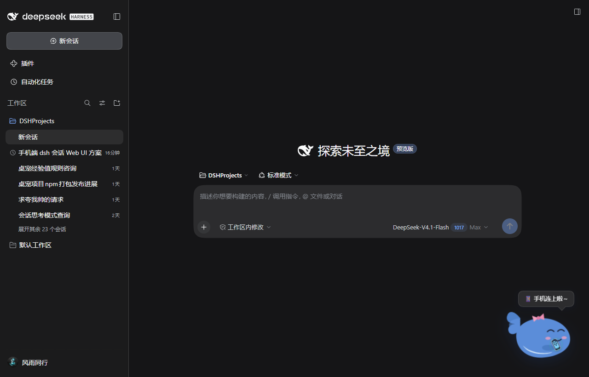

# @zyfgood/dsh-mobile 📱

[](https://www.npmjs.com/package/@zyfgood/dsh-mobile)
[](LICENSE)
[](https://github.com/zyfgood/dsh-mobile)
[](https://github.com/deepseek-ai/deepseek-harness)

> DeepSeek Harness（DSH）插件：**手机端 Web UI**。在同一个局域网里，用手机浏览全部 DSH 会话、实时查看回复、继续对话；桌面端左下角提供一个带二维码的入口。

这不是把桌面 Web GUI 简单缩小的响应式页面，而是一个独立的、为手机重写的轻量客户端：会话列表、聊天记录、流式输出、工具调用折叠、历史翻页、新建会话和停止回复都针对触屏重新设计。宿主端直接复用 DSH 的 `ctx.sessionController`，不直接读写 session JSONL，也不修改会话内容。

## 界面

| 会话列表 | 继续对话 |
|---|---|
|  |  |

| Markdown / 表格 | 登录页 |
|---|---|
|  |  |

## 桌宠联动

配合 [`@zyfgood/dsh-whale-girl`](https://github.com/zyfgood/dsh-whale-girl) 0.3.0+：

- 鲸鱼右侧鳍里拿着一部小手机；点击手机打开/关闭手机端面板，面板锚定在桌宠上方；
- 右键菜单新增 **📱 手机访问**（兜底入口）；
- 手机首次连上时，桌宠挥手说“手机连上啦～”，手机出现呼吸光环；
- 桌宠隐藏时，手机面板入口自动回退到左下角按钮；单击桌宠仍然是戳戳，双击/拖拽不变；
- 没装桌宠或桌宠版本过旧时，手机端保持原来的独立按钮，不会报错。




客户端服务契约（`ctx.provide('dshMobile', ...)`）：

```js
{
  version: 1,
  open(anchor?), close(), toggle(anchor?),
  getSnapshot(),   // { open, anchor, status, error, externalLauncher }
  subscribe(fn),
  setExternalLauncher(enabled)  // 桌宠接管入口时隐藏左下角按钮
}
```

其他桌宠也可以按同一契约接入；服务只负责 UI 开关和状态，不接触手机端令牌。

---

## 为什么需要它

调研结论：DSH 桌面版目前**不能直接**把 Web GUI 暴露给手机。

| 现状 | 影响 |
|---|---|
| 桌面宿主固定以 `--host 127.0.0.1 --port 0` 启动 Web Host（`dsh-desktop-host`） | 手机无法访问；也没有桌面 UI 可改这个绑定 |
| Web GUI 的登录令牌只接受在 `GET /` 上兑换，Cookie 绑定 hostname + port | 即使把服务绑到局域网 IP，也要重新走令牌/端口绑定，且默认没有移动端布局 |
| `dsh web --host 0.0.0.0` 明确不支持；Host/Origin 信任只接受 loopback、绑定 IP 或 `trustedHosts` | 反向代理现有 GUI 会被 Cookie authority 与请求信任拦住 |
| 现有 GUI 是桌面优先的聊天布局 | 手机上可用性差，不适合“快速看一眼、回一句”的场景 |

因此本插件采用**独立手机端 HTTP 服务**的方案：

```
┌────────────────────────── DSH 宿主进程 ──────────────────────────┐
│                                                                  │
│  桌面 Web GUI (127.0.0.1:35788)                                 │
│    └─ /dsh-mobile/status, /dsh-mobile/qr.svg  ← 已登录桌面才能看  │
│                                                                  │
│  ctx.sessionController  ── list / page / follow / prompt / ...   │
│         ▲                                                        │
│         │ 直接调用                                                │
│  dsh-mobile 宿主端（本插件）                                      │
│    └─ 手机端 HTTP(S) 服务  0.0.0.0:35888                         │
│         ├─ 访问令牌 + 签名 HttpOnly Cookie                        │
│         ├─ REST：会话列表、历史分页、新建、继续、停止              │
│         └─ SSE：snapshot / record / assistant-stream             │
└──────────────────────────────────────────────────────────────────┘
                          ▲
                          │ 同一 Wi-Fi / 局域网
                    📱 手机浏览器
```

关键点：

- **不碰桌面 Web Host 的绑定和登录态**，不改 profile 的 `host`，也不需要重启桌面应用。
- 手机端有**自己的访问令牌**，持久化在 `~/.dsh/dsh-mobile/state.json`；二维码里带的是这个令牌，不是桌面登录令牌。
- 会话读写全部走 `sessionController`，与桌面 GUI、飞书机器人共享同一套会话记录。
- SSE 直接转发 `sessionController.follow()` 的 `snapshot` / durable `event` / `assistant-stream` 帧，所以手机能看到模型的流式输出和工具调用过程。

---

## 安装

### 从 npm 安装（web / 非桌面 profile）

```powershell
dsh plugin --profile web add @zyfgood/dsh-mobile
```

### 从 GitHub Release / tgz 安装

```powershell
# 预构建 tgz（版本固定）
dsh plugin --profile web add https://github.com/zyfgood/dsh-mobile/releases/download/v0.1.0/zyfgood-dsh-mobile-0.1.0.tgz
```

> ⚠️ **桌面版不能用 `dsh plugin --profile desktop add`**：desktop profile 由 Electron 应用独占管理，CLI 会直接拒绝（`profile "desktop" is managed exclusively by the Electron application`）。桌面版请用下面的 GUI 或本地脚本。

### 桌面版（推荐：插件页）

1. 打开 DSH 桌面 Web GUI。
2. 左侧 **插件** → 安装插件 / 从本地安装。
3. 填入 `@zyfgood/dsh-mobile`、`D:\DSHProjects\dsh-mobile` 或 tgz 路径，启用插件。
4. 如果页面提示需要重启，完全退出并重新启动 DeepSeek Harness。
5. 启动后左下角出现 📱 按钮。

### 桌面版（本地脚本，等价的手动安装）

如果插件页没有“本地路径”入口，可以使用仓库里的脚本。它会备份 profile 文件、创建 `node_modules` 链接、把包加入 `dependencies` 与 `dsh.profile.bundles`，并写入一条 `dsh-mobile` 配置：

```powershell
powershell -ExecutionPolicy Bypass -File D:\DSHProjects\dsh-mobile\scripts\install-desktop.ps1
```

完成后**完全退出并重新启动** DeepSeek Harness。脚本只改 `~/.dsh/profiles/desktop` 下的 `package.json`、`cordis.patch.yml` 和 `node_modules` 链接，不会执行 pnpm，也不会动会话数据。

### Web / 非桌面 profile

非 desktop 的普通 profile 可以用 CLI：

```powershell
# 例如 web profile
dsh plugin --profile web add D:\DSHProjects\dsh-mobile
# 或从 tgz
dsh plugin --profile web add D:\DSHProjects\zyfgood-dsh-mobile-0.1.0.tgz
```

### 卸载

桌面版在 **插件** 页禁用/移除；或手动删除 profile 中的依赖、bundle 行和 `node_modules\@zyfgood\dsh-mobile` 链接。`cordis.patch.yml` 里的 `dsh-mobile` 行可以保留（禁用状态）或删除。

## 插件市场

本插件按 DSH 生态的公开约定发布：

- npm 包声明了 `dsh` 清单、`dsh-plugin` / `deepseek-harness` 关键词和 `dsh.catalog` 元数据，供自动索引的市场收录；
- GitHub 仓库带有 `dsh-plugin` topic；
- 精选目录 [`awesome-dsh-plugin`](https://github.com/awesome-dsh-plugin/awesome-dsh-plugin) 通过 `data/plugins/zyfgood__dsh-mobile.yml` 提交，`dshmarket` 和目录站会按日同步。

> 市场收录由目录维护者审核，不等同于安全审计；安装第三方插件前请自行确认来源。

---

## 使用

1. 确认手机和电脑在**同一个局域网**（同一 Wi-Fi，或手机能访问电脑的局域网 IP）。
2. 在桌面 Web GUI 左下角点 📱。
3. 用手机相机/浏览器扫描二维码，或复制链接发到手机打开。
4. 首次打开会自动用二维码里的令牌登录；之后 30 天内免登录。
5. 在会话列表点任意会话 → 查看历史 → 在底部输入框继续对话。
6. 如果当前回复正在运行，输入框右下角会显示停止按钮；新消息默认排队，当前轮结束后自动处理。

> 二维码链接形如 `http://192.168.1.23:35888/#token=...`。令牌放在 URL fragment 里，不会随 HTTP 请求发送到服务器；页面加载后由 JS 读取并 `POST /api/login` 换取 HttpOnly Cookie，然后从地址栏清掉。

### 首次手机打不开？

最常见的原因是 Windows 防火墙。桌面宿主进程是 `DeepSeek Harness.exe`；如果它没有允许入站，手机就连不上 35888 端口。

- 在 Windows 安全中心 → 防火墙和网络保护 → 允许应用通过防火墙，勾选 `DeepSeek Harness`（或 Node.js）的**专用网络**；
- 或者给端口 35888 添加入站规则（需要管理员）；
- 确认手机连的是电脑同一个网段，而不是访客 Wi-Fi / 开了 AP 隔离；
- 关掉 VPN/代理后重试（有些 VPN 会把局域网路由劫持）。

---

## 配置

在 profile 的 `cordis.patch.yml` 中给插件加 `config`，例如：

```yaml
- id: dsh-mobile
  name: '@zyfgood/dsh-mobile'
  config:
    host: 0.0.0.0
    port: 35888
    accessToken: '至少16个字符的固定访问码'
```

| 字段 | 默认 | 说明 |
|---|---|---|
| `enabled` | `true` | 关闭后不启动手机端服务，桌面入口仍可显示错误 |
| `host` | `0.0.0.0` | 监听地址；`0.0.0.0` 表示所有 IPv4 网卡，`127.0.0.1` 表示仅本机 |
| `port` | `35888` | 监听端口；`0` 由系统分配 |
| `autoPort` | `true` | 端口被占用时自动尝试 35888–35898 |
| `publicHost` | `''` | 手机访问使用的主机名/IP；留空自动挑最佳局域网 IPv4 |
| `accessToken` | `''` | 固定访问码（≥16 字符）；留空自动生成并持久化 |
| `tlsCertFile` / `tlsKeyFile` | `''` | 可选 TLS；两者必须同时配置，配置后二维码使用 `https://` |
| `includeSubagents` | `false` | 会话列表包含子代理会话（只读查看，不能直接发消息） |
| `maxSessions` | `300` | 最多展示的会话数 |
| `pageSize` | `40` | 每次加载的历史消息数 |
| `heartbeatSeconds` | `15` | SSE 心跳间隔 |
| `cookieMaxAgeDays` | `30` | 手机登录 Cookie 有效期 |
| `defaultCwd` | `''` | 新建会话默认工作目录；留空沿用最近会话 |
| `allowNewSession` | `true` | 允许手机端新建会话 |
| `desktopPanel` | `true` | 是否在桌面 GUI 显示 📱 入口 |

修改 `accessToken` 会让所有已登录手机失效（Cookie 里的令牌指纹不匹配）。删除 `~/.dsh/dsh-mobile/state.json` 会同时轮换令牌和 Cookie 签名密钥。

---

## 安全模型

这是一个**局域网内**的访问方案，不是公网穿透。默认 HTTP 下，令牌和消息内容在 Wi-Fi 链路上是明文；对安全敏感的场景请配置 TLS，或只在自己信任的网络使用。

已实现：

- **访问令牌**：32 字节随机令牌（或自定义 ≥16 字符），持久化文件，二维码只给已登录的桌面端；
- **签名 Cookie**：HMAC-SHA256，`HttpOnly`、`SameSite=Strict`、`Path=/`；TLS 时加 `Secure`；
- **令牌指纹**：Cookie payload 里带令牌哈希前缀，轮换令牌立即失效旧 Cookie；
- **登录限速**：单 IP 15 分钟最多 20 次失败尝试；
- **Origin / Sec-Fetch-Site 检查**：拒绝跨站写请求；
- **CSP / X-Frame-Options / nosniff / no-referrer**：页面不可被嵌套，脚本只允许同源；
- **请求体上限** 256KB，登录体 16KB；
- **桌面入口受桌面登录态保护**：`/dsh-mobile/status` 和 `/qr.svg` 都过 `ctx.connection.requestRejection()`，未登录桌面拿不到令牌。

未实现 / 注意：

- 没有公网穿透、账号体系、设备管理、远程吊销列表；要吊销就换 `accessToken` 或删状态文件；
- 手机端目前不支持**审批**（approval）操作，只显示“等待批准，请在桌面端处理”。默认 `danger-full-access` profile 不会弹审批；
- 不支持从手机上传附件/图片；文本对话优先；
- 子代理会话默认不显示；即使打开也仅只读；
- 手机端服务与桌面 GUI 同进程，DSH 退出后手机端不可用。

---

## 手机端功能

- **全部会话**：标题、工作目录、相对更新时间、运行中/新会话/子会话/待迁移状态、任务进度；
- **搜索**：按标题、目录、会话 ID 本地过滤；
- **实时聊天**：用户/助手气泡、思考过程折叠、Markdown（标题/列表/代码块/链接/加粗）；
- **流式输出**：模型 text/reasoning delta 实时上屏；
- **工具调用**：工具卡片、参数、状态、结果折叠，失败标红；
- **历史翻页**：SSE 首屏只取最近一页，点“加载更早的消息”继续向前翻；
- **继续对话**：POST prompt，默认排队；运行中可停止；
- **新建会话**：选择/输入工作目录，创建后直接进入；
- **断线重连**：EventSource 自动重连；重连后以新的 snapshot 重建；
- **PWA**：可“添加到主屏幕”，全屏运行。

---

## 宿主 API（手机端服务）

所有 `/api/*`（除 `/api/health`、`/api/me`、`/api/login`）都要求登录 Cookie。

| 方法 | 路径 | 说明 |
|---|---|---|
| GET | `/api/health` | 健康检查，无鉴权 |
| GET | `/api/me` | 登录状态与客户端配置 |
| POST | `/api/login` | `{ token }` → 设置 Cookie |
| POST | `/api/logout` | 清除 Cookie |
| GET | `/api/sessions` | 会话列表（`sessionController.list`） |
| POST | `/api/sessions` | `{ cwd }` 新建会话（`create`） |
| GET | `/api/sessions/:id` | 单个会话元数据 |
| GET | `/api/sessions/:id/stream` | SSE：`snapshot` / `record` / `assistant` / `error` |
| GET | `/api/sessions/:id/page?throughSeq=&beforeSeq=&maxMessages=` | 历史分页（`page`） |
| POST | `/api/sessions/:id/prompt` | `{ text, mode? }` 继续对话（`prompt`） |
| POST | `/api/sessions/:id/cancel` | 停止当前回复（`cancel`） |

桌面入口：

| 方法 | 路径 | 说明 |
|---|---|---|
| GET | `/dsh-mobile/status` | 服务状态、局域网 URL、带令牌链接（需桌面登录态） |
| GET | `/dsh-mobile/qr.svg` | 访问二维码 SVG（需桌面登录态） |

SSE 帧：

- `snapshot`：`{ header, cursor, records, hasMore, projections, assistantStream? }`
- `record`：一个 durable `SessionEvent`
- `assistant`：模型流式帧（`start` / `chunk` / `end`）
- `error`：`{ ok:false, error, code? }`

浏览器端按 `seq` 去重；收到新的 `snapshot` 会清空并重建当前会话，所以断线重连不会产生重复消息。

---

## 开发

```
lib/index.js          宿主端：HTTP(S) 服务、认证、REST/SSE、QR、桌面状态路由
lib/client.js         桌面 Web GUI 客户端插件：左下角 📱 面板
lib/web/index.html    手机端页面
lib/web/app.js        手机端逻辑（无构建步骤，原生 ES module）
lib/web/style.css     手机端样式（自动深色模式）
lib/web/icon.svg      PWA / 图标
lib/vendor/qrcode.mjs 二维码生成（qrcode-generator，MIT）
cordis.patch.yml      官方安装时自动插入插件行
```

本地检查：

```powershell
cd D:\DSHProjects\dsh-mobile
node --check lib/index.js
node --check lib/client.js
node --check lib/web/app.js
npm pack
```

修改宿主端 `lib/index.js` 或 `lib/web/*` 后都需要重载插件（或重启 DSH）；静态文件在插件启动时读入内存，单纯刷新手机页面不会加载新资源。

### 调试

- 手机端服务启动日志：DSH 宿主日志里搜 `[dsh-mobile]`；
- 状态文件：`~/.dsh/dsh-mobile/state.json`（含 `token` 与 `cookieSecret`，注意保密）；
- 健康检查：`http://127.0.0.1:35888/api/health`；
- 查看实际端口：桌面 📱 面板里的“运行中 · 端口 xxxx”。

---

## 已知限制

- 依赖桌面宿主进程运行；DSH 退出后手机端不可用。
- 只支持 IPv4 局域网；IPv6-only 网络需要自己配 `publicHost` 和反向代理。
- 默认 HTTP 是明文；公网/不可信 Wi-Fi 请配 TLS 或使用 VPN。
- 不支持审批、附件上传、语音输入、会话删除/归档、模型切换。
- 子代理会话只读；`includeSubagents: true` 时能看到但不能直接发消息。
- 如果会话正被其他写者（另一个进程/飞书机器人）持有，打开或继续可能失败；错误会显示在手机端。
- 桌面 GUI 的 `/dsh-mobile` 路由依赖 `webServer` + `connection` 服务；headless profile 只会有手机端服务，没有桌面入口。

---

## 项目

| | |
|---|---|
| 仓库 | [github.com/zyfgood/dsh-mobile](https://github.com/zyfgood/dsh-mobile) |
| npm | [@zyfgood/dsh-mobile](https://www.npmjs.com/package/@zyfgood/dsh-mobile) |
| 问题反馈 | [GitHub Issues](https://github.com/zyfgood/dsh-mobile/issues) |
| 更新记录 | [CHANGELOG.md](CHANGELOG.md) |
| 精选目录 | [awesome-dsh-plugin](https://github.com/awesome-dsh-plugin/awesome-dsh-plugin) |

## English

**dsh-mobile** is a mobile web UI plugin for DeepSeek Harness. A plugin-owned,
token-protected HTTP server on the LAN lists every session through
`ctx.sessionController`, streams durable events and assistant output over SSE,
and lets a phone continue any conversation. The desktop GUI exposes a QR entry
from `/dsh-mobile/status`. It does not change the desktop host's loopback
binding or reuse its login cookie.

```bash
dsh plugin --profile web add @zyfgood/dsh-mobile
```

## License

MIT。二维码库 `qrcode-generator` 也是 MIT，见 `lib/vendor/LICENSE-qrcode.txt`。
